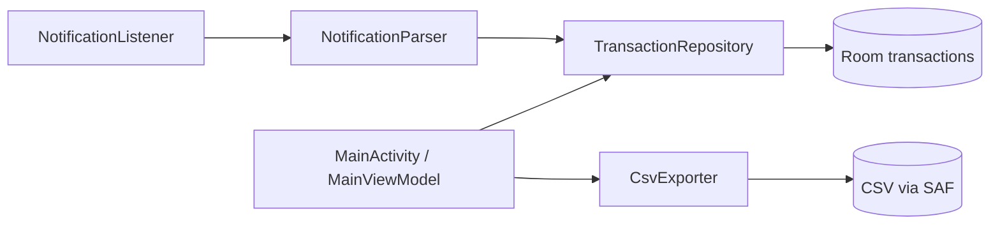

# Project Context

Living snapshot of the project's verified state. Replace stale facts; never append history.

_Last verified: 2026-11-19_

## Verified Stack

| Field | Value |
| --- | --- |
| Runtime/language | Kotlin 2.1.0 on JVM 17, Android minSdk 26 / targetSdk 35 |
| Framework | Android Jetpack Compose (Material 3, Compose BOM 2024.12.01) |
| Package manager | Gradle 8.11.1 with version catalog `android/gradle/libs.versions.toml` |
| Database | Room 2.6.1 (SQLite on device, `dompet.db`, schema version 2 with migration 1→2 adding `transferGroup`) |
| Cache/queue | none |
| Frontend | Jetpack Compose, single activity, no navigation library |
| Build/test commands | `cd android && ./gradlew assembleDebug`, `./gradlew testDebugUnitTest` (JUnit 4 + `org.json` 20240303 for JVM tests), `./gradlew installDebug` (JDK 17 from Android Studio `jbr`, SDK path in untracked `local.properties`) |
| Deployment/container | Debug APK sideloaded; no Play Store release yet |

## Application Flow

Two views of the same application. Per-feature detail belongs in `docs/specs/` and `docs/plans/`.

### User Flow

- [user] `Beranda` → `+` → isi nominal, tipe, kategori → transaksi tersimpan: catat manual
- [user] notifikasi bank/e-wallet masuk → `Konfirmasi` → setujui / ubah tipe / buang (baris disimpan sebagai DISCARDED agar tidak muncul lagi): transaksi otomatis
- [user] top up antar dompet sendiri (misal Jago → GoPay) → `Konfirmasi` menampilkan satu kartu `Pindah dana` → `Setujui` atau `Bukan, pisahkan`; bisa juga ditandai manual lewat sakelar di form transaksi: pindah dana tidak dihitung sebagai masuk/keluar
- [user] `Ringkasan` → pilih bulan → total, pembanding bulan lalu, per kategori, per sumber, 5 pengeluaran terbesar: lihat ringkasan
- [user] `Pengaturan` → buka izin akses notifikasi → pilih aplikasi sumber: setup awal
- [user] `Pengaturan` → `Saldo per dompet` → pilih dompet → isi saldo sekarang, tandai utama → Beranda menampilkan saldo tiap dompet (utama di atas): saldo per dompet
- [user] `Pengaturan` → `Batas pengeluaran bulanan` → isi nominal → Beranda menampilkan sisa, persentase terpakai, dan sisa hari: batas bulanan
- [user] `Pengaturan` → `Simpan backup` → pilih lokasi → file JSON berisi semua transaksi (semua status), kata kunci, dompet, batas, dan pilihan aplikasi sumber: backup
- [user] `Pengaturan` → `Pulihkan dari backup` → pilih file → app memvalidasi seluruh isi → dialog konfirmasi menyebut jumlah transaksi → semua data di HP diganti: pulihkan / pindah HP
- [user] `Pengaturan` → `Ekspor CSV` → pilih lokasi file → file CSV transaksi terkonfirmasi untuk spreadsheet (tidak bisa dipakai memulihkan): ekspor
- [user] `Pengaturan` → `Kelola kata kunci` (layar sendiri, berisi kata pengguna dan kata bawaan parser) → `Tambah kata kunci` → kata + masuk/keluar + aplikasi → notifikasi berikutnya terbaca: ajari format bank baru

### System Flow

- `TransactionNotificationListener` → `NotificationParser` (kata kunci pengguna dari `KeywordPrefs` dicek sebelum kata bawaan) → `TransactionRepository` → Room `transactions` (status PENDING): notifikasi dari aplikasi sumber yang diaktifkan (Gojek dan Shopee opt-in), notifikasi chat diabaikan, duplikat dicegah lewat `dedupKey` SHA-256 plus cek isi sama dalam 2 menit; baris baru dipasangkan sebagai pindah dana (`transferGroup` sama) dengan baris PENDING berlawanan arah, nominal sama, sumber lain, dalam 10 menit
- `MainActivity` UI → `MainViewModel` → `TransactionRepository` → Room `transactions`: input manual, konfirmasi, hapus
- `MainViewModel` → `CsvExporter` → Storage Access Framework file: ekspor CSV
- `MainViewModel` → `BackupCodec` (JSON via `org.json`, format `dompet-bersama-backup` versi 1, maks 20 MB) → Storage Access Framework file; pulihkan lewat `TransactionRepository.replaceAll` dalam satu transaksi Room lalu mengganti SharedPreferences

### Flow Diagram

## Modules & Access

- Modules: `data` in `android/app/src/main/java/id/dompetbersama/data` — Room entity, DAO, repository, preferensi sumber, kata kunci pengguna, serta saldo dompet, dompet utama, dan batas bulanan (SharedPreferences `sources`, `keywords`, `wallets`, `backup`)
- Modules: `notification` in `android/app/src/main/java/id/dompetbersama/notification` — listener service dan parser notifikasi
- Modules: `ui` in `android/app/src/main/java/id/dompetbersama/ui` — layar Compose dan ViewModel
- Authentication: none (single user, lokal)
- Roles: none
- Approval chain: none

## Environments & Jobs

- Environments: local device only, no remote database
- Scheduled jobs and workers: none (NotificationListenerService dijalankan sistem saat izin akses notifikasi aktif)

## Architecture Notes

Satu modul Gradle `app`. Dependency dibuat manual di `DompetApp` (tanpa Hilt). Semua data tinggal di perangkat; backend dan sharing antar user ditunda.

## Important Integrations

- Android NotificationListenerService: membaca notifikasi aplikasi bank/e-wallet yang dipilih user di Pengaturan.
- Git remote: `https://github.com/delvinalfredo/dompet.git` (branch `main`).

## Conventions

- Data classification: standard (aplikasi pribadi satu user tanpa server; maker-checker dan audit trail tidak berlaku). Tetap: nominal disimpan sebagai `Long` rupiah, teks notifikasi dimasking sebelum disimpan, tidak ada logging isi notifikasi, database dan preferensi dikecualikan dari cloud backup dan transfer antar-HP (`res/xml/data_extraction_rules.xml`).
- Satu notifikasi = satu transaksi: `dedupKey` unik (sumber + tipe + nominal + menit posting).
- Transaksi dari notifikasi selalu masuk sebagai PENDING sampai user konfirmasi.
- Dompet = nama `source` transaksi (label aplikasi atau `Manual`). Saldo dompet = saldo yang diisi user + transaksi CONFIRMED sejak saat diisi (pindah dana ikut dihitung); batas bulanan memakai total pengeluaran bulan ini tanpa pindah dana.
- Pindah antar dompet sendiri: baris tetap INCOME/EXPENSE per sisi, ditandai `transferGroup`, dikecualikan dari total, kategori, per sumber, dan pengeluaran terbesar; CSV menulis tipe `pindah masuk` / `pindah keluar`.
- Parser modular: tambah aturan per aplikasi di `notification/` tanpa mengubah listener.

## Known Constraints

- Format notifikasi tiap bank berubah tanpa pemberitahuan; parser bersifat best-effort, makanya ada antrean konfirmasi.
- Beberapa vendor HP (Xiaomi, Oppo, Vivo) mematikan listener di background; user perlu menonaktifkan optimasi baterai.
- Akses notifikasi dibatasi kebijakan Google Play; distribusi saat ini sideload APK.

> Do not store secrets, tokens, passwords, or private credentials here.
